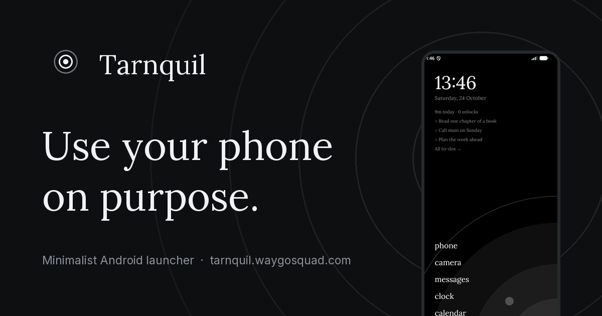

# Tarnquil — Landing Page

> The website for **[Tarnquil](https://github.com/thisisprabhat/DetoxDesk)**, a quiet, text-only Android launcher that helps you use your phone on purpose.

**Live:** [tarnquil.waygosquad.com](https://tarnquil.waygosquad.com) · **App:** [Google Play](https://play.google.com/store/apps/details?id=com.waygosquad.tarnquil) · **App source:** [thisisprabhat/DetoxDesk](https://github.com/thisisprabhat/DetoxDesk)



A single static page plus a privacy policy, built to load fast, rank well and convert visitors into installs. There are no trackers and no cookies, and nothing loads from third parties at runtime: a privacy-first app should have a privacy-first website.

---

## Highlights

- **SEO-first, static HTML.** All copy is server-rendered. The site has one H1, a canonical URL, Open Graph and Twitter cards, and JSON-LD (`SoftwareApplication`, `WebSite`, `Organization`, `FAQPage`). It also ships a generated `sitemap.xml`, `robots.txt` and an `llms.txt` for AI crawlers.
- **Minimal, purposeful motion.** Sections fade in once on scroll, concentric arcs "breathe" slowly behind the hero, and an interactive replica of the app's *pause → choose a session* screen shows the core idea. The tour video plays only while it's on screen. Every animation respects `prefers-reduced-motion`.
- **Works without JavaScript.** Every section, FAQ answer and screenshot is visible with JS disabled. Scripts only enhance the page.
- **Light & dark.** Follows the OS colour scheme by default, with a manual toggle that remembers the choice. Light mode swaps in light-theme app captures, not just CSS colours.
- **Optimised assets.** App screenshots are converted to responsive AVIF/WebP at build time. Fonts (Lora + Inter) are self-hosted woff2. Each asset is there because it shows something the copy can't. The reasoning is in the [design spec §6](docs/specs/2026-10-24-tarnquil-landing-design.md#6-asset-usage-map).
- **Tested.** 46 Playwright checks (SEO tags, JSON-LD, FAQ parity, motion, no-JS, reduced motion, responsive overflow, axe accessibility, JS budget), plus `html-validate` and Lighthouse CI budgets.

## Tech stack

| | |
|---|---|
| Framework | [Astro 5](https://astro.build) (static output, zero framework JS) |
| Styling | Plain CSS with design tokens (`src/styles/tokens.css`) |
| Fonts | `@fontsource/lora`, `@fontsource/inter` (self-hosted) |
| Images | `astro:assets` + `sharp` → AVIF/WebP `srcset` |
| Illustrations | [`@lucasmarkes/hairline`](https://www.npmjs.com/package/@lucasmarkes/hairline) isometric line figures |
| Testing | Playwright, `@axe-core/playwright`, `html-validate`, Lighthouse CI |
| Package manager | pnpm |

## Getting started

Requires **Node 20+** and **pnpm**.

```bash
pnpm install
pnpm dev          # http://localhost:4321
```

### Scripts

| Command | What it does |
|---|---|
| `pnpm dev` | Start the dev server |
| `pnpm build` | Build the static site into `dist/` |
| `pnpm preview` | Serve `dist/` locally |
| `pnpm test` | Run the Playwright suite (builds and previews automatically) |
| `pnpm lint:html` | Validate the built HTML |
| `pnpm lhci` | Run Lighthouse CI against `dist/` |
| `pnpm check` | Build, then lint, run the Play-id guard and run the tests. **Run before every deploy.** |
| `pnpm sync:assets` | Re-copy app assets from the app repo (see below) |

Run `npx playwright install chromium` once before the first test run.

## Configuration

Everything that identifies the product lives in **one file**: [`src/config/site.ts`](src/config/site.ts).

```ts
export const SITE_URL = "https://tarnquil.waygosquad.com";
export const PLAY_PACKAGE = "com.waygosquad.tarnquil";   // Google Play application id
```

Every Play link, the JSON-LD, `llms.txt` and the `google-play-app` meta tag are built from `PLAY_PACKAGE`. `pnpm check` fails if the package id is hard-coded anywhere else. The page copy, FAQ, feature list and theme list are in the same file.

## Assets

App screenshots, the tour video, favicons, social cards and the privacy policy come from the app repo's `assets/` folder. They are **committed here** so the site builds without the app repo. To refresh them after an app UI change:

```bash
# expects the app repo at ../../apps/DetoxDesk by default
TARNQUIL_APP_ROOT=/path/to/DetoxDesk pnpm sync:assets
pnpm check
```

The copy list is an explicit allowlist in [`scripts/sync-assets.mjs`](scripts/sync-assets.mjs). The script exits with an error and lists every missing file.

## Project structure

```
src/
├── config/site.ts           all constants: URLs, Play id, copy, FAQ, features, themes
├── layouts/Base.astro       <html>, <head>, header, footer
├── components/
│   ├── Seo.astro            meta, OG/Twitter, JSON-LD
│   ├── sections/            Hero, How, Features, Themes, Privacy, Faq, Download
│   ├── PauseDemo.astro      interactive session-picker replica
│   ├── PhoneFrame.astro     CSS device frame for screenshots and video
│   └── Arcs.astro, PlayBadge.astro, HairlineFigure.astro, Header.astro, Footer.astro
├── lib/jsonld.ts            structured data builder
├── pages/                   index, privacy, 404, sitemap.xml, llms.txt
├── scripts/enhance.ts       scroll reveal, in-view video, pause demo, theme toggle
├── styles/                  tokens.css, global.css
├── content/privacy-policy.md
└── assets/                  screenshots, themes, hero, video (optimised at build)
public/                      favicons, social cards, robots.txt, manifest, security.txt, Play badge
tests/                       seo, sections, motion, responsive, a11y specs
docs/                        design spec and implementation / launch plans
```

## Deployment

### Docker

The included multi-stage [`Dockerfile`](Dockerfile) builds the site with Node 22 and serves it from nginx using [`nginx.conf`](nginx.conf). That config sets security headers, long caching for hashed assets, and a 404 page. It also has a `/health` endpoint, which the container healthcheck uses.

```bash
docker build -t tarnquil-landing .
docker run --rm -p 8080:80 tarnquil-landing   # http://localhost:8080 · health: /health
```

This works as-is on Coolify or any other Docker host.

### Any static host

`pnpm build` outputs a plain static folder (`dist/`) that any static host can serve: nginx, Cloudflare Pages, Netlify, GitHub Pages. Recommended headers (HSTS, CSP, immutable caching for `/_astro/*`), the 301 from alias hosts, and the Search Console and Play Console steps are in [docs/plans/2026-10-24-launch-and-seo.md](docs/plans/2026-10-24-launch-and-seo.md).

`/privacy` is the privacy-policy URL used in the Play Console listing, so keep it at that exact path.

## Documentation

- [Design spec](docs/specs/2026-10-24-tarnquil-landing-design.md): goals, information architecture, visual system, motion rules, asset map, SEO requirements, quality bars
- [Implementation plan](docs/plans/2026-10-24-landing-page-implementation.md)
- [Launch & SEO plan](docs/plans/2026-10-24-launch-and-seo.md)

## License

The code is licensed under the [Apache License 2.0](LICENSE), the same as the Tarnquil app.

The Tarnquil name, logo and app screenshots identify the Tarnquil app. Please don't use them to represent a different product. Google Play and the Google Play logo are trademarks of Google LLC.

---

Made by [Prabhat Kumar](https://waygosquad.com) · WayGoSquad
